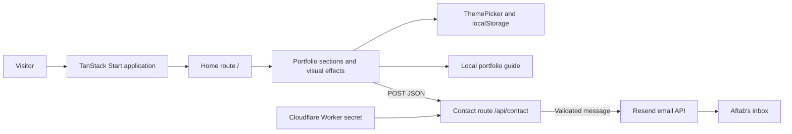

<div align="center">
  

# Hey Aftab

**Aftab Uddin Ahmad — Portfolio**

A cinematic, interactive portfolio tracing a path from computer science to AI engineering.

[](package.json)
[](package.json)
[](package.json)

[**Explore the portfolio**](https://hey-aftab.lovable.app) · [Download CV](public/Aftab_Uddin_Ahmad_AI_Engineer_CV.docx) · [LinkedIn](https://www.linkedin.com/in/aftab-uddin-ahmad-7b303429/) · [Lovable editor](https://lovable.dev/projects/e52edce0-65e2-4a83-8041-ddd760fd261c)

<sub>Dhaka, Bangladesh · Computer Science & Engineering · United International University</sub>

</div>

---

## Contents

- [Overview](#overview)
- [Features](#features)
- [Featured work](#featured-work)
- [Tech stack](#tech-stack)
- [Architecture](#architecture)
- [Installation](#installation)
- [Usage](#usage)
- [Configuration](#configuration)
- [Contact API](#contact-api)
- [Project structure](#project-structure)
- [Demo and visual assets](#demo-and-visual-assets)
- [Contributing](#contributing)
- [License](#license)
- [Project status and links](#project-status-and-links)

## Overview

Hey Aftab is the personal portfolio of **Aftab Uddin Ahmad**, a Computer Science & Engineering student at United International University preparing for a career in AI engineering. A responsive, single-page experience brings together his background, education, technical skills, projects, achievements, engineering mindset, and career timeline. Expected B.Sc. graduation is **2028**.

The visual identity pairs deep slate and warm amber with orbital geometry, interactive star fields, and cinematic section transitions. Visitors can switch to aqua-blue or warm daylight themes while exploring the same content.

> [!TIP]
> **Reviewing Aftab's work?** Start with the [live portfolio](https://hey-aftab.lovable.app), explore the [featured projects](#featured-work), then download the [AI-engineering focused CV](public/Aftab_Uddin_Ahmad_AI_Engineer_CV.docx).

## Features

| Experience               | What it includes                                                                                                                      |
| ------------------------ | ------------------------------------------------------------------------------------------------------------------------------------- |
| Profile and education    | Hero portrait, location, career direction, degree, university, and expected graduation.                                               |
| Filterable skills        | Programming, frontend, backend, database, and infrastructure categories.                                                              |
| Project showcase         | Five featured projects with descriptions, visual summaries, and available source, demo, or presentation links.                        |
| Achievements and journey | Third place in a 12-hour team hackathon, an engineering workflow, and a timeline covering milestones and future plans.                |
| Resume and contact       | Downloadable DOCX CV; email, phone, LinkedIn, GitHub, and Facebook links; a contact form with delivery feedback.                      |
| Three persistent themes  | **Amber night**, **Ocean glow**, and **Soft daylight**, saved in browser storage.                                                     |
| Cinematic interaction    | Scroll reveals, cursor effects, project tilt, lighting, and a canvas star field, with reduced-motion and pointer capability handling. |
| Portfolio guide          | Floating chat interface with quick questions and curated answers about Aftab's background and work.                                   |
| Navigation and metadata  | Mobile navigation, active-section tracking, a skip-to-content link, page metadata, robots rules, and a sitemap route.                 |

### How the portfolio guide works

The assistant matches questions against a local knowledge base in [`PortfolioAssistant.tsx`](src/components/portfolio/PortfolioAssistant.tsx). It provides concise, professional answers about education, skills, career goals, projects, achievements, and profile links, and acknowledges when a detail is unavailable.

> [!NOTE]
> The guide uses curated text matching. It does not call an AI model, fetch live social-profile content, or use an external API. Keep its answers factual and aligned with the public portfolio when updating the site.

## Featured work

These projects are **presented by the portfolio**, rather than implemented in this repository. Descriptions reflect the portfolio's current content.

| Project                                 | Focus                                                                                                                                                         | Available links                                                                                                      |
| --------------------------------------- | ------------------------------------------------------------------------------------------------------------------------------------------------------------- | -------------------------------------------------------------------------------------------------------------------- |
| **National Healthcare Record Exchange** | Healthcare information system presentation covering authentication, role-based workflows, clinical records, notifications, and relational data management.    | [Source](https://github.com/heyaftab/national-healthcare-record-exchange) · [Presentation](https://nhre.lovable.app) |
| **Goynar Gontobbo**                     | Jewellery commerce platform in development, connecting a Next.js storefront with a Laravel API and MySQL data model.                                          | Described in the portfolio                                                                                           |
| **BozoScope**                           | Browser camera app built solo in a 40-minute challenge, with nine filters, photo capture, and local downloads; first place at UIU Developers Hub's Tech Adda. | [Demo link](https://lnkd.in/gNA4abVE)                                                                                |
| **UIU CSE Course Planner**              | Course search, trimester planning, and credit tracking using FastAPI and SQLite.                                                                              | [Source](https://github.com/heyaftab/uiu-course-planner)                                                             |
| **Smart CNC Plotter**                   | Team-built automated plotting prototype connecting microcontroller programming, motor control, and hardware interfacing.                                      | [Project details](https://lnkd.in/p/gNNXr2y6)                                                                        |

## Tech stack

| Layer                   | Technologies used by this repository                                                             |
| ----------------------- | ------------------------------------------------------------------------------------------------ |
| Interface               | React 19, TypeScript                                                                             |
| Application and routing | TanStack Start, TanStack Router, TanStack Query provider                                         |
| Styling and components  | Tailwind CSS 4, Radix UI primitives, Lucide React icons                                          |
| Build and server target | Vite 8, Lovable's TanStack Vite configuration, Nitro with Cloudflare as the default build target |
| Contact delivery        | Server-side Resend HTTP API integration                                                          |
| Quality tooling         | ESLint, Prettier, Vitest, Testing Library, jsdom                                                 |
| Typography              | Bricolage Grotesque, Manrope, JetBrains Mono via Google Fonts                                    |

Dependency declarations and scripts live in [`package.json`](package.json). Technologies mentioned in project cards or skill categories describe Aftab's broader work and are separate from this portfolio's stack.

## Architecture

TanStack Start provides the application shell and server rendering. The home route renders the portfolio, while the contact endpoint forwards validated messages to Resend. The custom server entry passes Cloudflare environment bindings into request context and handles server-rendering failures.



Portfolio content is maintained in source files. This repository does not implement a database or persist contact submissions in one; delivery happens through the email provider.

## Installation

### Requirements

- Node.js **20.19+ within the 20.x release line, or 22.12+**, with npm (matching the installed Vite 8 engine requirement: `^20.19.0 || >=22.12.0`).
- Git to clone the repository.

### Start locally

```sh
git clone https://github.com/heyaftab/hey-aftab.git
cd hey-aftab
npm install
npm run dev
```

Vite prints the local development URL after the server starts. Contact email delivery requires the separate [Worker configuration](#enable-contact-email-delivery).

## Usage

Browse the sections, filter skill cards, cycle through themes, and open the floating guide to ask about Aftab's work. The Resume section downloads the CV. The contact form submits to `/api/contact`; the email link remains available for direct contact when delivery is unavailable or unconfigured.

### Available commands

| Command              | Purpose                               |
| -------------------- | ------------------------------------- |
| `npm run dev`        | Start the local development server.   |
| `npm run build`      | Create a production build.            |
| `npm run build:dev`  | Create a development-mode build.      |
| `npm run preview`    | Preview the production build locally. |
| `npm run lint`       | Run ESLint across the project.        |
| `npm test`           | Run the Vitest test suite once.       |
| `npm run test:watch` | Run Vitest in watch mode.             |
| `npm run format`     | Format files with Prettier.           |

To build and preview:

```sh
npm run build
npm run preview
```

Existing tests cover routing, contact form behavior, theme selection, visual effects, motion physics, and portfolio regressions. Test configuration lives in [`vitest.config.ts`](vitest.config.ts).

## Configuration

### Update portfolio content

| Change                                                                 | Where to edit                                                                                        |
| ---------------------------------------------------------------------- | ---------------------------------------------------------------------------------------------------- |
| Page copy, skills, projects, achievements, timeline, and contact links | [`src/components/portfolio/Portfolio.tsx`](src/components/portfolio/Portfolio.tsx)                   |
| Guide questions, answers, and profile links                            | [`src/components/portfolio/PortfolioAssistant.tsx`](src/components/portfolio/PortfolioAssistant.tsx) |
| Theme colors, design tokens, and global styles                         | [`src/styles.css`](src/styles.css)                                                                   |
| Theme interaction                                                      | [`src/components/portfolio/ThemePicker.tsx`](src/components/portfolio/ThemePicker.tsx)               |
| Page title and social metadata                                         | [`src/routes/index.tsx`](src/routes/index.tsx) and [`src/routes/__root.tsx`](src/routes/__root.tsx)  |
| Contact recipient and sender                                           | [`src/routes/api/contact.ts`](src/routes/api/contact.ts)                                             |

Theme IDs are `night`, `ocean`, and `light`; the picker cycles through them in that order and saves the selection under `portfolio-theme` in `localStorage`.

- Replace `public/assets/Aftab.png` to update the hero portrait. Keep the filename or update its path in `Portfolio.tsx`.
- Replace `public/Aftab_Uddin_Ahmad_AI_Engineer_CV.docx` to update the CV. Keep the filename or update the resume path in `Portfolio.tsx`.
- Update portfolio copy and assistant answers together so the guide remains consistent with the page.

### Enable contact email delivery

| Setting          | Location                                                                   | Purpose                                              |
| ---------------- | -------------------------------------------------------------------------- | ---------------------------------------------------- |
| `RESEND_API_KEY` | Cloudflare Worker secret; ignored `.dev.vars` for local Worker development | Authorizes server-side email delivery.               |
| Recipient        | `INBOX` in `src/routes/api/contact.ts`                                     | Currently `aftabuddinahmad26@gmail.com`.             |
| Sender           | `from` in `src/routes/api/contact.ts`                                      | Currently `Aftab Portfolio <onboarding@resend.dev>`. |

1. Create a Resend account and generate an API key.
2. Add `RESEND_API_KEY` to the Cloudflare Worker as a secret. The existing setup documentation identifies the Worker as `heyaftab-hey-aftab`; deploy the updated Worker after configuring it.
3. For initial checks with Resend's default test sender, use a recipient address verified in Resend. For unrestricted delivery, verify a domain you control and update the `from` address in `src/routes/api/contact.ts`.

For local **Worker** development, place the binding in the ignored `.dev.vars` file:

```dotenv
RESEND_API_KEY=replace-with-your-resend-api-key
```

The route reads this binding from Cloudflare request context. The `.dev.vars` file is for local Worker development; creating it alone does not guarantee that `npm run dev` supplies the binding to the route.

> [!IMPORTANT]
> Keep the API key server-side. Never place it in client code or commit it. When the binding is absent, the endpoint returns `503` with `email_not_configured`, and the form directs visitors to email Aftab directly.

## Contact API

**Endpoint:** `POST /api/contact` · **Content type:** `application/json`

```json
{
  "name": "Portfolio visitor",
  "email": "visitor@example.com",
  "message": "I'd like to discuss a software engineering opportunity.",
  "website": ""
}
```

| Field     | Validation                                                                                                         |
| --------- | ------------------------------------------------------------------------------------------------------------------ |
| `name`    | Trimmed string, 2–120 characters.                                                                                  |
| `email`   | Trimmed string matching the route's email pattern, at most 254 characters.                                         |
| `message` | Trimmed string, 10–2,000 characters.                                                                               |
| `website` | Honeypot: leave empty or omit. A string that remains nonempty after trimming is accepted without forwarding email. |

The handler rejects mismatched origins when an `Origin` header is present. It also rejects requests whose declared `Content-Length` exceeds 8,192 bytes. Messages use the visitor's address as **Reply-To**, so Aftab can reply directly.

| HTTP status | JSON response                                                                                                 |
| ----------- | ------------------------------------------------------------------------------------------------------------- |
| `200`       | `{ "ok": true }` after successful delivery, or a discarded honeypot submission.                               |
| `400`       | `{ "error": "invalid_request" }`, or an error value of `invalid_name`, `invalid_email`, or `invalid_message`. |
| `403`       | `{ "error": "invalid_origin" }`.                                                                              |
| `413`       | `{ "error": "request_too_large" }`.                                                                           |
| `502`       | `{ "error": "delivery_failed" }` when the provider rejects the message or delivery throws.                    |
| `503`       | `{ "error": "email_not_configured" }` when the Worker secret is missing.                                      |

## Project structure

```text
hey-aftab/
├── public/
│   ├── assets/
│   │   ├── Aftab.png                  Hero portrait
│   │   └── site-logo.png              Site logo
│   ├── Aftab_Uddin_Ahmad_AI_Engineer_CV.docx
│   ├── favicon.ico
│   └── robots.txt
├── src/
│   ├── components/
│   │   ├── portfolio/
│   │   │   ├── Portfolio.tsx          Main sections and portfolio content
│   │   │   ├── PortfolioAssistant.tsx Local knowledge-based guide
│   │   │   ├── ThemePicker.tsx        Theme cycle and selection controls
│   │   │   ├── LightSpiderCursor.tsx  Light-theme skeletal spider cursor
│   │   │   ├── effects.tsx            Shared visual effects and motion
│   │   │   ├── CinematicEffects.tsx   Scroll, lighting, and scene effects
│   │   │   └── SpaceGravity.tsx       Canvas star field and interactions
│   │   └── ui/                       Reusable UI components
│   ├── hooks/                        Shared React hooks
│   ├── lib/                          Physics, sitemap, utilities, error handling
│   ├── routes/
│   │   ├── __root.tsx                Shell, global metadata, and providers
│   │   ├── index.tsx                 Home route and page metadata
│   │   ├── api/contact.ts            Server-side email endpoint
│   │   └── sitemap[.]xml.ts          Sitemap endpoint
│   ├── test/                         Vitest tests and setup
│   ├── router.tsx                    Router configuration
│   ├── routeTree.gen.ts              Generated route tree
│   ├── server.ts                     Server entry and Cloudflare context
│   ├── start.ts                      Request middleware
│   └── styles.css                    Design tokens, themes, global styles
├── package.json                      Dependencies and commands
├── vite.config.ts                    Lovable/TanStack build configuration
└── vitest.config.ts                  Test configuration
```

## Demo and visual assets

**[Open the live experience →](https://hey-aftab.lovable.app)**

Explore **Amber night → Ocean glow → Soft daylight** using the theme picker, then open the portfolio guide and browse the project cards to see the interactions in context.

The repository includes the [hero portrait](public/assets/Aftab.png), [site logo](public/assets/site-logo.png), and [downloadable CV](public/Aftab_Uddin_Ahmad_AI_Engineer_CV.docx). No application screenshots are currently committed; the live portfolio is the visual demo.

## Contributing

For changes, keep portfolio content accurate, update related guide answers, and check the experience on desktop and mobile. For interface changes, check all three themes, keyboard navigation, and reduced-motion behavior. Run the relevant validation before submitting a pull request:

```sh
npm run lint
npm test
npm run build
```

### Lovable workflow

This repository is connected to [Lovable](https://lovable.dev) and can be edited in the [project editor](https://lovable.dev/projects/e52edce0-65e2-4a83-8041-ddd760fd261c). Commits pushed to the connected branch sync back to the editor.

> [!IMPORTANT]
> Keep the connected branch in a working state. Do not rewrite published Git history through force pushes or by rebasing, amending, or squashing commits that have already been pushed; this can cause project history to be lost on Lovable's side.

## License

No license file is currently included in this repository, and `package.json` does not declare a license. Reuse terms need to be specified by the maintainer.

## Project status and links

The portfolio is published at [hey-aftab.lovable.app](https://hey-aftab.lovable.app). Contact email delivery depends on the Worker secret and sender configuration described above. No repository roadmap is currently documented; the career timeline on the site includes future plans for Aftab.

For opportunities, questions, or project discussions, contact **Aftab Uddin Ahmad** at [aftabuddinahmad26@gmail.com](mailto:aftabuddinahmad26@gmail.com).

[Live portfolio](https://hey-aftab.lovable.app) · [GitHub](https://github.com/heyaftab) · [LinkedIn](https://www.linkedin.com/in/aftab-uddin-ahmad-7b303429/) · [Facebook](https://www.facebook.com/aftabuddinahmad26/) · [CV](public/Aftab_Uddin_Ahmad_AI_Engineer_CV.docx) · [Lovable editor](https://lovable.dev/projects/e52edce0-65e2-4a83-8041-ddd760fd261c)
